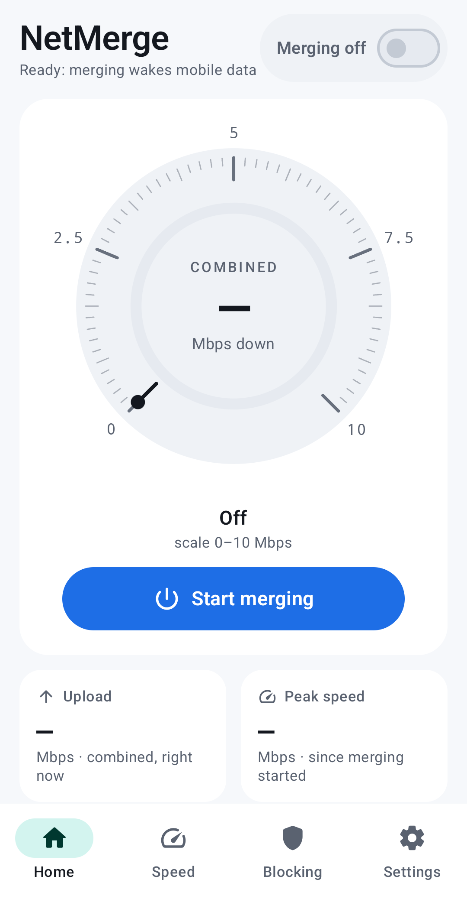
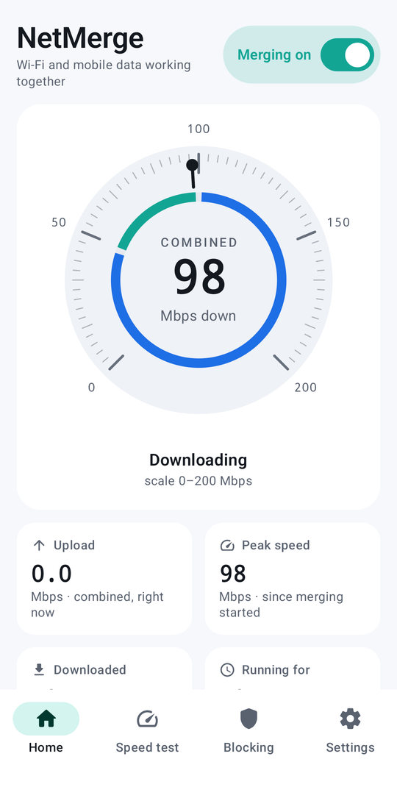
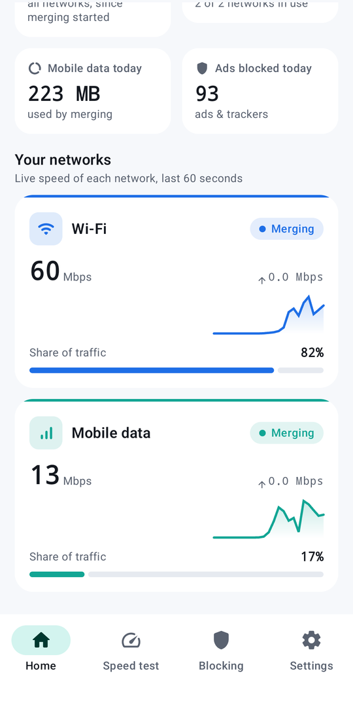
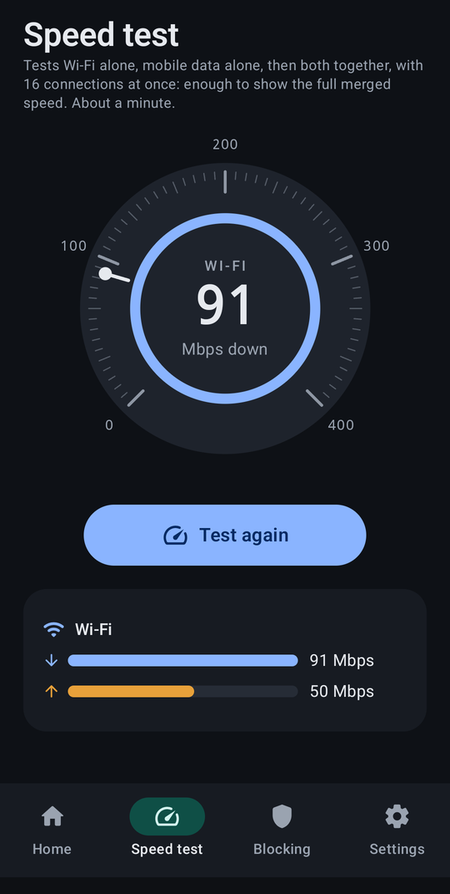
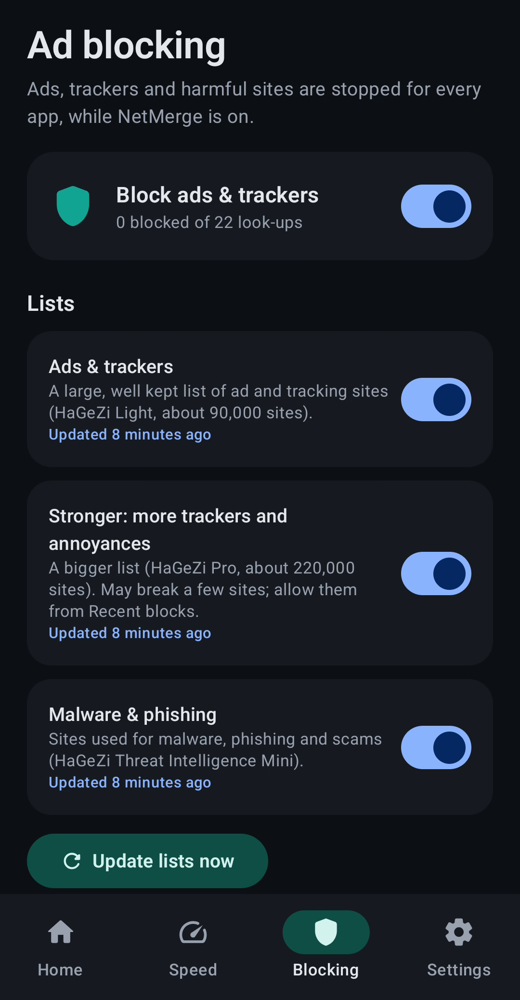
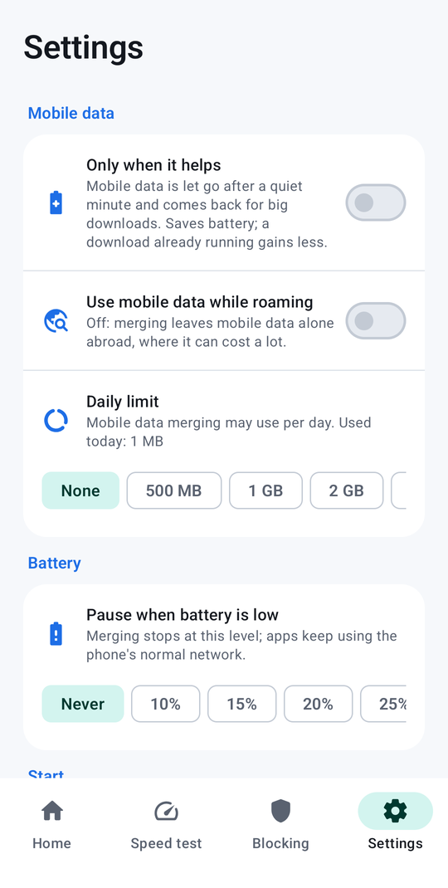

# NetMerge for Android (test builds)

Uses Wi-Fi and mobile data at the same time on an Android phone, the way NetMerge merges a PC's connections. The app
runs a VPN on the phone that catches every app's traffic; each **new connection** goes out on Wi-Fi or mobile data,
more of them on the faster one. Downloads, app stores, browsers and streaming open many connections and get faster;
one single connection still uses one network.

**Status: working test builds, not released; tested on six phone models.** Measured on a Galaxy S26 Ultra: about +38% for downloads with many
connections when both networks are fast; dropping a network in the middle of a download stalls it for under 3 s.
Results, costs and open questions: [docs/feasibility-results.md](docs/feasibility-results.md).

## Screenshots

On a Galaxy S26 Ultra (Android 17), from the phone tests.

| Home, off | Home, merging | Each network |
| --- | --- | --- |
|  |  |  |

| Speed test | Ad blocking | Settings |
| --- | --- | --- |
|  |  |  |

More in [docs/screenshots](docs/screenshots): dark mode, the speed test before it runs, the rest of the settings.

## What is in it

| Part | What it does |
| --- | --- |
| `engine/` (Go, built with gomobile) | The VPN's packet engine (tun2socks / gVisor) and the splitter that picks a network per connection (`split/`, unit-tested) |
| `app/` | The app: screen with live speed per network, settings, the VPN service, quick settings tile |
| `probe/` | A separate test app that behaves like any app (pages, downloads, battery and long-run tests) |
| `ci/` | What runs on the emulators for every change |

The splitter learns each network's speed from what it carries, keeps it while idle, gives a network that has not
shown its speed a fair chance, and gives a network far slower than the fastest only a trickle of new connections.
When a network leaves, its connections are closed at once so apps reconnect on the one that works.

Settings: mobile data only when it helps (let go after a quiet minute, back for big downloads; off by default), a
daily limit for mobile data used by merging, and a battery guard (pause merging when the battery falls to a chosen
level, start again by itself once it has charged back to a second level; off by default).

## How it is tested

Latest results, test by test: **[docs/test-results.md](docs/test-results.md)**.

1. `go test ./split ./dnsblock` for the engine.
2. Every change runs on Android emulators (API 34 and 35) with Wi-Fi and mobile data: both networks, merged pages and
   downloads, Wi-Fi switched off mid-download, mobile data on demand, daily limit, roaming, apps left out, battery
   guard, the tile, ad blocking, the speed test, the release build, and the engine's 16 KB page alignment.
3. Firebase Test Lab runs the app on real phones of other makers (Samsung, Google, Motorola, Oppo, Xiaomi) and virtual
   ones, weekly and by hand (`.github/workflows/testlab.yml`).
4. A real phone (Galaxy S26 Ultra, Android 17) runs every feature over adb: speed, dropouts, battery guard, ad
   blocking, restart with Always-on VPN, hours-long runs.

Test builds are signed with a public test key (`app/test-signing.jks`) so a new build installs over the last one;
a release will use a private key.
