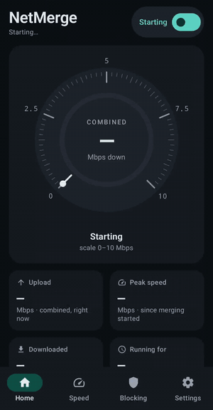

# NetMerge for Android

Uses Wi-Fi and mobile data at the same time on an Android phone, the way NetMerge merges a PC's connections. The app
runs a VPN on the phone that catches every app's traffic; each **new connection** goes out on Wi-Fi or mobile data,
more of them on the faster one. Downloads, app stores, browsers and streaming open many connections and get faster;
one single connection still uses one network.

**Status: public beta** ([latest release](https://github.com/nisar87/netmerge-android/releases); install the APK from
there; NetMerge offers each new version itself). Not on Google Play yet. Android 10 or newer; targets Android 16 and
supports 16 KB memory pages (both needed for Google Play). Tested on seven real phone models: Galaxy S26 Ultra (every
feature, real mobile data), and in Firebase Test Lab a Galaxy S22, Pixel 8a, Motorola razr plus 2024, Oppo and Xiaomi
14 (Android 13 to 16), plus virtual phones on Android 10 and 14. Measured on the Galaxy S26 Ultra: about +38% for downloads with many connections
when both networks are fast; a network dropping mid-download stalls it for under 1 s. Test by test:
[docs/test-results.md](docs/test-results.md); first measurements and costs: [docs/feasibility-results.md](docs/feasibility-results.md).

## Features

- **Merging:** each new connection goes out on Wi-Fi or mobile data, more of them on the faster one; NetMerge learns
  each network's speed and how quickly it answers. A very slow mobile network gets almost nothing, so web pages are
  not held up by it.
- **Dropouts:** when a network leaves, its connections close at once and apps carry on over the other one.
- **Home:** a speed dial with the combined download in the middle and a ring showing each network's share; download
  and upload shown apart; each network's own graph and share; upload, peak, downloaded, running time, mobile data and
  ads blocked today.
- **Speed test, built in:** Wi-Fi alone, mobile data alone, then both together, download and upload, with 16
  connections at once (enough to show what merging adds); says how much mobile data it used.
- **Ad and tracker blocking:** block lists (HaGeZi) for every app while NetMerge is on; ads and trackers, a stronger
  list, malware and phishing; an allow list.
- **Mobile data settings:** only when it helps (let go after a quiet minute, back for big downloads), a daily limit,
  and never while roaming unless allowed.
- **Battery guard:** merging pauses at a battery level you choose (apps keep the normal network) and starts again by
  itself once charged to a second level.
- **Apps left out of merging**, for apps that do not work with a VPN.
- **Starts by itself** after a restart with Android's Always-on VPN; a **quick settings tile**; a notification with the
  live speed.
- **Your traffic is yours:** it goes straight out on your own networks, never through a server of ours; no account,
  no ads, no tracking.
- **Diagnostics** (a switch, on by default, on the welcome screen and in Settings), so bugs on other people's phones
  can be found and fixed: see [Diagnostics](#diagnostics).

## Screenshots and video

Version 0.2.0-beta.4 on a Galaxy S26 Ultra (Android 17), 14 November 2026. The room has slow Wi-Fi (about 6–9 Mbps)
and a weak mobile signal, so the numbers are small; what matters is both networks working at once.

The full video, 48 seconds: [docs/media/netmerge-demo.mp4](docs/media/netmerge-demo.mp4) (merging on, a download, each
screen, merging off).

| Home, off | Home, merging | Each network |
| --- | --- | --- |
|  |  |  |

| Speed test | Ad blocking | Settings |
| --- | --- | --- |
|  |  |  |

More in [docs/screenshots](docs/screenshots): Home and the speed test in dark mode, the rest of the settings.

## Diagnostics

With **Send diagnostics** on (the default; off in Settings or on the welcome screen), NetMerge sends a small report
every 6 hours or so, on Wi-Fi only:

- NetMerge's own event log: starts and stops, network changes, mobile data held or let go, battery pauses, and what
  each network carried (one line a minute);
- its settings (apps left out and allowed sites as a count, not by name);
- the phone's make, model and Android version, NetMerge's version, and a random number made at install that tells one
  phone's reports from another's;
- after a crash: where in NetMerge it crashed, sent at the next start.

Never sent: the sites or apps you use, addresses, your traffic, your name or account, any phone identifier. Reports go
to the project's own Firebase database (`netmerge-app`), which the app may only add to: it cannot read anything back,
not even its own reports ([diagnostics/firestore.rules](diagnostics/firestore.rules)). Turning it off deletes a crash
report that has not gone out yet.

## What is in it

| Part | What it does |
| --- | --- |
| `engine/` (Go, built with gomobile) | The VPN's packet engine (tun2socks / gVisor) and the splitter that picks a network per connection (`split/`, unit-tested) |
| `app/` | The app: screen with live speed per network, settings, the VPN service, quick settings tile |
| `probe/` | A separate test app that behaves like any app (pages, downloads, battery and long-run tests) |
| `ci/` | What runs on the emulators for every change |

The splitter learns each network's speed from what it carries and how long it takes to answer a new connection, keeps
it while idle, gives a network that has not shown its speed a fair chance (for 20 s at most), and gives a network far
slower than the fastest, or far slower to answer, only a trickle of new connections. DNS questions go to the best
network first. When a network leaves, its connections are closed at once so apps reconnect on the one that works.

## How it is tested

Latest results, test by test: **[docs/test-results.md](docs/test-results.md)**.

1. `go test ./split ./dnsblock` for the engine.
2. Every change runs on Android emulators (API 34 and 35) with Wi-Fi and mobile data: both networks, merged pages and
   downloads, Wi-Fi switched off mid-download, mobile data on demand, daily limit, roaming, apps left out, battery
   guard, the tile, ad blocking, the speed test, the release build, and the engine's 16 KB page alignment.
3. Firebase Test Lab runs the app on real phones of other makers (Samsung, Google, Motorola, Oppo, Xiaomi) and virtual
   ones, weekly and by hand (`.github/workflows/testlab.yml`).
4. A real phone (Galaxy S26 Ultra, Android 17) runs every feature over adb: speed, dropouts, battery guard, ad
   blocking, restart with Always-on VPN, hours-long runs.

Releases are signed with the private release key (kept in the repository's encrypted secrets; see
`.github/workflows/release.yml`), so each beta installs over the last one with settings kept. Test builds from CI are
signed with a public test key (`app/test-signing.jks`): a phone with a test build must uninstall it once before
installing a release.
